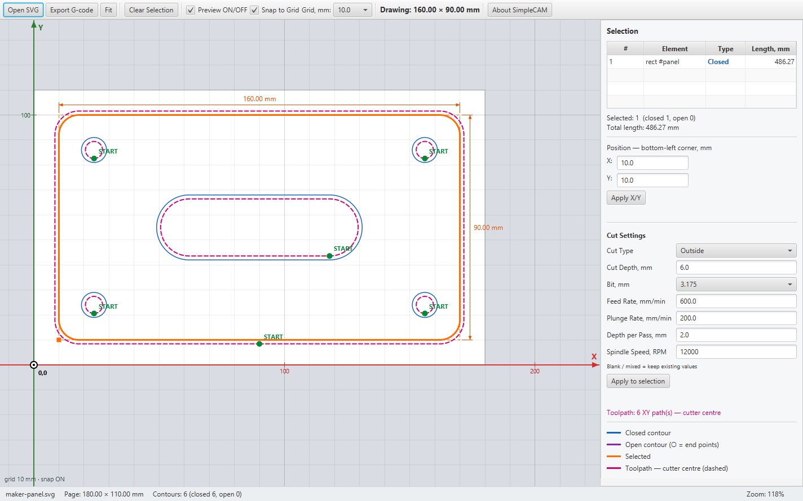
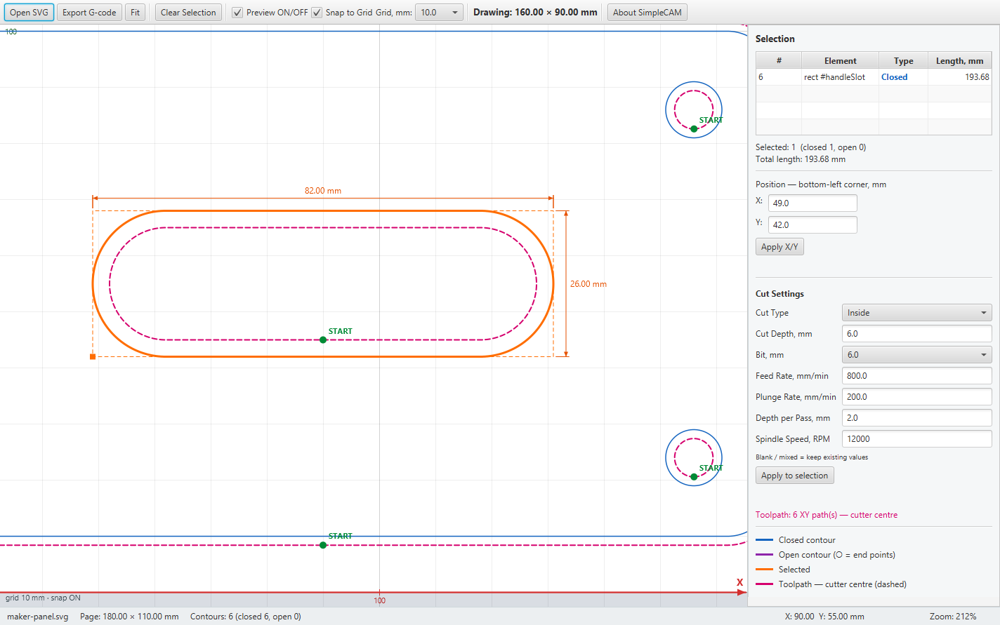
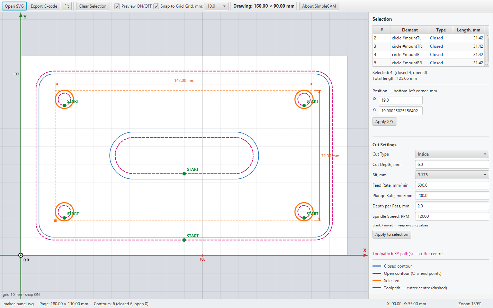

# SimpleCAM 1830 🍒

[](https://github.com/lamilami/DaniCNC/releases/download/v1.0-SNAPSHOT/SimpleCAM-1830-1.0-SNAPSHOT-Windows-x64.zip)

**Simple 2D CAM for CNC hobbyists.**

From an SVG drawing to GRBL G-code, in a straightforward desktop workspace.
Open your design, choose how to cut it, check the toolpath and export.

*Made for makers, not subscriptions.*



## Start cutting your design

1. **Open SVG** — load your drawing.
2. **Select a contour** — set the tool diameter, cut depth, depth per pass, feed, plunge and spindle speed.
3. **Choose On Path, Inside or Outside** — see the cutter-centre toolpath update immediately.
4. **Export G-code** — save the selection or the entire drawing as a GRBL `.nc` file.

Right-click a contour or toolpath to **set its start point**, **reverse its direction** or **export the selection**.
The green **START** marker shows where cutting begins. Each separate toolpath keeps its own start and direction as you adjust the cut.

## A small workspace with useful tools

- SVG import with dimensions in millimetres.
- Zoom, pan, grid snapping and precise X/Y placement.
- Multiple selection with **Ctrl + Click** and shared cutting settings.
- Inside/outside tool compensation powered by **Clipper2-java**.
- Open and closed contours, including compound SVG paths with holes.
- Toolpath preview and G-code export with multiple depth passes.
- **About SimpleCAM** in the toolbar, with credits, version and offline license notices.

Toolpath edits leave the imported SVG geometry intact. For closed paths, the start can be anywhere along a segment; for open paths, choose either end.

<details>
<summary>More screenshots — inside cuts and shared settings</summary>

**Inside cut with a custom start point**



**Select several contours and edit their cutting settings together**



Try the drawing: [maker-panel.svg](samples/maker-panel.svg).

</details>

## Windows — unzip and run

Extract the complete **Windows x64 ZIP**, open the `SimpleCAM` folder and double-click **`SimpleCAM.exe`**.

Java and JavaFX are included. No separate Java installation, Maven or installer is needed.
Keep the `app` and `runtime` folders beside the executable. Sample SVG drawings are included in `samples`.

## Current scope

SimpleCAM prepares **2D toolpaths and GRBL G-code**. Pocket clearing, holding tabs, 3D machining and direct machine control are not implemented.
Real-machine validation is still pending.

The export uses **Z0 at the material surface** and a **Z+5 mm retract**. Check the generated program, work zero and clamp clearance before running it on your CNC.

## Build it yourself

On Windows, use a **JDK 23 or newer** with `JAVA_HOME` configured:

```powershell
.\mvnw.cmd compile javafx:run
```

Run the tests:

```powershell
.\mvnw.cmd test
```

Build the portable Windows x64 ZIP with a Windows x64 JDK:

```powershell
powershell -NoProfile -ExecutionPolicy Bypass -File scripts/package-windows.ps1
```

The packaging script runs the tests and writes the ZIP and SHA-256 checksum to `target/dist`.

## Credits

**Responsible Person** — [Daniel Denkov](https://github.com/lamilami)

**Software Development** — Claude · Anthropic; Codex · OpenAI

**Architecture & Technical Assistance** — ChatGPT · OpenAI

Built with **Kotlin**, **JavaFX** and **Clipper2-java**. Full third-party notices are available in the application's **About → Licenses** tab and [THIRD-PARTY-NOTICES.txt](src/main/resources/org/example/danicnc/THIRD-PARTY-NOTICES.txt).

**Special Thanks** — To the open-source community and everyone making useful tools freely available.
